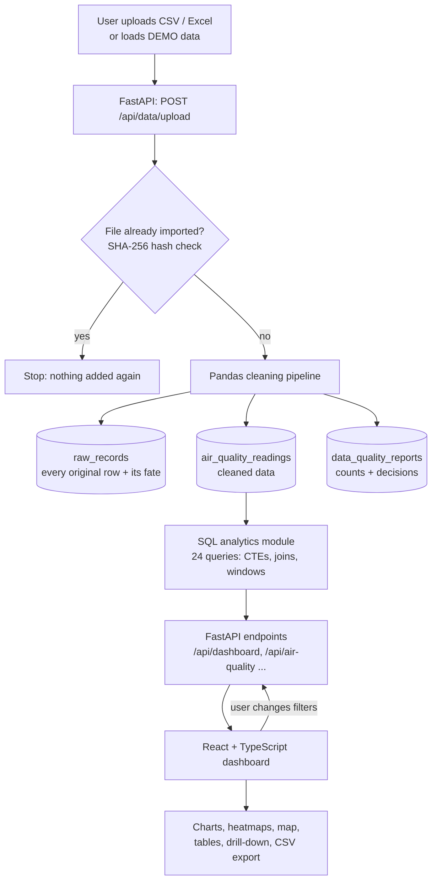
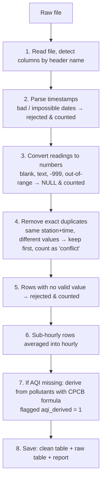
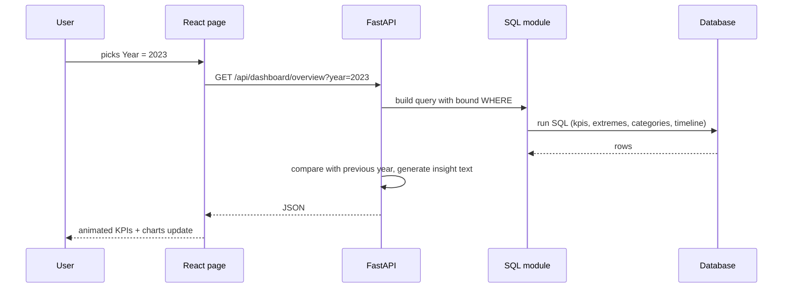

# Bengaluru Air Quality Intelligence System — Project Guide & Interview Prep

*Everything explained from scratch, in simple words.*

---

## 1. The project in one minute

**Problem:** Air-quality readings for Bengaluru come from many monitoring stations, in many files, and the data is messy: blank values, duplicate rows, wrong dates, odd units. Nobody can easily answer "which area is worst, when, and why?"

**Solution:** A web app that
1. takes a raw CSV/Excel file,
2. **cleans** it (and keeps a record of everything it did),
3. **stores** it in a database,
4. answers questions with **SQL queries**,
5. shows the answers in an **interactive dashboard**.

**One-line pitch for interviews:**
> "I built a full-stack data analytics platform: a Pandas pipeline cleans messy air-quality data transparently, SQL queries do the analysis, and a React dashboard on a FastAPI backend lets users explore hotspots, trends and data quality."

---

## 2. Big-picture flowchart



Plain-text version:

```
Upload file → FastAPI → duplicate-file check → Pandas cleaning
   → saves 3 things: raw rows | clean readings | quality report
   → SQL queries read the clean readings
   → API sends results as JSON → React draws charts
   → user changes a filter → new request → charts update
```

---

## 3. The cleaning pipeline (the data-engineering heart)



**Key rules (memorise these):**
- **Missing is never zero.** A blank reading becomes `NULL`, not 0 — zero would falsely mean "clean air".
- **Nothing is silently dropped.** Every uploaded row is stored in `raw_records` with a status (`retained`, `duplicate`, `invalid_timestamp`…). The report proves:
  `original rows = cleaned + merged + duplicates + conflicts + bad timestamps + empty rows`.
- **Raw and clean data are separate**, so the process is reproducible and auditable.
- **Re-importing is safe**: a file hash check plus a database rule `UNIQUE(station_id, timestamp)` prevent double entries.
- **Demo data is separate** (`is_demo` flag) and never mixed with real data.

---

## 4. The database (5 tables)

| Table | What it stores |
|---|---|
| `monitoring_stations` | station name, latitude/longitude (only if the dataset has them) |
| `air_quality_readings` | one cleaned reading: station, time, AQI, PM2.5, PM10, NO₂, SO₂ (+ year, month, hour, weekday stored as columns) |
| `data_imports` | one row per uploaded file: name, hash, status, counts |
| `raw_records` | untouched copy of every uploaded row + what happened to it |
| `data_quality_reports` | the processing report for each import (JSON) |

**Why year/month/hour are stored as columns:** it makes the SQL simple and portable between MySQL and SQLite (date functions differ between them).

**Why indexes/unique constraints:** unique `(station_id, ts)` stops duplicates; indexes make filtered queries fast.

---

## 5. SQL analytics (the "brain")

Every number on the dashboard comes from a SQL query in `backend/app/sql_analytics/queries.py` — **24 queries** listed in the SQL Explorer page.

**SQL concepts in simple words**

| Concept | Meaning | Where used |
|---|---|---|
| `GROUP BY` + `AVG/MAX/COUNT` | summarise many rows into one number | average AQI per station |
| `JOIN` | combine tables | readings + station names |
| CTE (`WITH`) | a named temporary step, keeps queries readable | rankings, yearly trends |
| Subquery | a query inside a query | latest reading per station |
| `CASE` | if/else | AQI → "Good/Moderate/Poor" |
| `RANK()` / `DENSE_RANK()` | position in an ordered list | most polluted station |
| `LAG()` / `LEAD()` | look at previous / next row | year-over-year change |
| `SUM() OVER ()` | total across all rows without collapsing | % share of each category |
| `HAVING` | filter groups | duplicates (count > 1) |

**Example in words:** *Year-over-year change* → average AQI per year (CTE), then `LAG` fetches last year's average on the same row, then `(this − last) / last × 100`.

**Filters** (year, month, station, date range) are turned into a safe, parameterised `WHERE` clause (`scope.py`) — never string-pasted from user input, so it is protected against SQL injection.

---

## 5b. Request flow when a user clicks a filter



---

## 6. Backend (FastAPI) — how it's organised

```
backend/app/
  main.py          app start, CORS, error handling
  config.py        settings from .env (database URL etc.)
  database.py      engine + sessions
  models.py        the 5 tables (SQLAlchemy)
  deps.py          reads filters from the URL; picks demo vs real dataset
  insights.py      writes sentences like "Peenya recorded the highest AQI…" from results
  pipeline/        cleaning.py (Pandas) · ingest.py (save) · demo_data.py
  sql_analytics/   queries.py · scope.py
  routers/         dashboard · air_quality · data_quality · data · sql_explorer
```

**Main endpoints:** `/api/dashboard/overview`, `/api/air-quality/{rankings, trends/yearly, trends/monthly, trends/hourly, pollutants, map, readings}`, `/api/data-quality/summary`, `POST /api/data/upload`, `/api/sql/queries`. Auto docs at `/docs`.

---

## 7. Frontend (React + TypeScript) — how it's organised

```
frontend/src/
  pages/        Landing, Overview, Rankings, Trends, Seasonal, Pollutants, MapPage, DataQuality, SqlExplorer
  components/   Mascot, Illustrations, FilterBar, DataTable, Heatmap, DrillDown, Layout, ui (cards, counters)
  context/      Filters (global filter state)
  hooks/        useApi (fetching with loading/error, keeps old data while reloading)
  lib/          api, aqi (categories/colours), csv export
```

**Pages:** Landing · Overview (KPIs) · Area Ranking · Historical Trends · Monthly & Hourly · Pollutants · Pollution Map · Data Quality (upload + report) · SQL Explorer.

**UI features:** animated counters, Framer Motion transitions, cloud mascot "Nimbus" that changes mood with AQI, heatmaps, Leaflet map with coloured markers, drill-down panel (click a chart point → see the raw readings), CSV export, empty/loading/error states, responsive layout.

**Why I stuck to honesty in the UI:** DEMO banner for synthetic data; map says "geospatial data incomplete" instead of guessing coordinates; pollutants missing from a dataset are hidden, not shown as zero.

---

## 8. AQI basics you must know

- **AQI** = Air Quality Index, a 0–500 score. India uses the **CPCB** scale.
- Categories: **Good** (0–50), **Satisfactory** (51–100), **Moderate** (101–200), **Poor** (201–300), **Very Poor** (301–400), **Severe** (401–500).
- **Pollutants:** PM2.5 (fine dust, deepest into lungs), PM10 (coarse dust, construction/road), NO₂ (vehicles), SO₂ (industry/fuel).
- AQI is the **worst** pollutant's sub-index. When AQI is missing I derive it (needs ≥3 pollutants incl. a PM) and flag it as derived.
- Typical patterns: worse in winter, better in monsoon; peaks near morning/evening rush hours.

---

## 9. What I tested and how

- **14 automated tests (pytest):** cleaning rules (duplicates, sentinels, bad dates, hourly merge, row accounting), every API endpoint, filter validation, repeated upload is idempotent, demo and real data stay separate, every SQL query runs.
- **Manual browser testing:** all pages, filters, drill-down, SQL Explorer, mobile width.
- **Performance work:** profiled queries on ~106k rows, added a covering index, rewrote slow queries, loaded SQL previews lazily (SQL Explorer from 9 s to 0.2 s list load).
- **Bug found and fixed:** SVG animation errors from animating `cx/cy/r` directly → switched to transforms.

---

## 10. Honest limitations (say these confidently — it shows maturity)

1. Built and tested on **SQLite**; MySQL support exists (schema script, same SQL) but **was not run on a live MySQL server**.
2. Demo data is **synthetic**; a real OpenCity file was not available, so column detection was tested on the demo file and synthetic variants only.
3. Only **wide format** files (one column per pollutant) are supported; long format returns a clear error.
4. Uploads are processed **synchronously** (tens of seconds for big files); for production use a background queue.
5. Derived AQI uses 24-hour breakpoints on instantaneous readings, an approximation (flagged).
6. At millions of rows you'd add pre-aggregated summary tables or caching.

**Future improvements:** background jobs (Celery/Redis), Docker, long-format support, forecasting (Prophet), alerts, real-time feeds, authentication.

---

## 11. Interview Q&A

**Q1. Walk me through the project.**
A user uploads an air-quality file. A Pandas pipeline validates and cleans it, recording every decision, and stores raw rows, clean readings and a quality report. SQL queries (CTEs, joins, window functions) compute rankings, trends and patterns. FastAPI exposes them, and a React dashboard visualises them with filters, maps and drill-down.

**Q2. Why SQL for analysis instead of Pandas?**
The requirement was SQL-centred analytics. SQL runs close to the data, scales better, is reusable by BI tools, and each chart is traceable to a query (the SQL Explorer page shows them). Pandas is used for cleaning, where row-wise logic is easier.

**Q3. How do you handle missing values?**
Blank or invalid values become NULL, never zero or a guessed average. They are counted per column and station and shown on the Data Quality page. Rows with no usable measurement are rejected but kept in `raw_records` with a reason.

**Q4. How do you avoid duplicates on repeated imports?**
Three layers: the file's SHA-256 hash (identical file → skipped), duplicate removal inside the file, and a database `UNIQUE(station_id, ts)` plus a pre-check that skips already-stored readings.

**Q5. Explain a window function you used.**
For year-over-year change: `LAG(avg_aqi) OVER (PARTITION BY station_id ORDER BY year)` gives last year's value on the same row, so `(avg − lag)/lag × 100` is the % change. `RANK() OVER (ORDER BY avg_aqi DESC)` ranks stations.

**Q6. Why a CTE?**
It names an intermediate result (e.g. yearly averages) so the final SELECT stays readable and I can reuse it for LAG/LEAD calculations.

**Q7. How are filters applied safely?**
The API builds a `WHERE` clause with bound parameters (`:year`, `:st0`…). User input never goes into the SQL string, preventing SQL injection. Only whitelisted column names are used for sorting.

**Q8. How did you keep demo and real data apart?**
An `is_demo` flag on stations, imports and readings, an `auto/real/demo` dataset parameter on every endpoint, and a visible DEMO banner. Real data takes priority once it exists.

**Q9. How do you know the cleaning is correct?**
Unit tests assert the row-accounting identity and each rule; the report shows `original = cleaned + removed categories`, flagged if it ever doesn't balance.

**Q10. What was the hardest problem?**
Making the cleaning transparent but fast. A per-row pandas lookup made the demo import ~4 minutes; replacing it with list-based bulk inserts cut it to under a minute. Also tuning slow SQL (duplicate detection) with a covering index.

**Q11. How does the map avoid wrong data?**
Coordinates only come from the dataset's latitude/longitude columns. Missing ones are reported as "geospatial data incomplete"; nothing is invented.

**Q12. How would you scale it?**
Background workers for uploads, PostgreSQL/MySQL with partitioning, pre-aggregated summary tables, Redis caching of dashboard queries, Docker deployment.

**Q13. Why FastAPI / React / TypeScript?**
FastAPI: fast, typed, automatic validation and docs. React: component model for a complex interactive UI. TypeScript: catches data-shape mistakes at build time.

**Q14. What would you add next?**
Forecasting with Prophet, anomaly/alert rules, long-format file support, authentication, Docker, and live data feeds.

**Q15. What did you learn?**
Data quality decisions matter more than charts; make cleaning auditable; profile before optimising; be honest about what is tested and what isn't.

---

## 12. 30-second and 2-minute explanations

**30 seconds:** "It's an air-quality analytics platform for Bengaluru. It cleans messy monitoring data without hiding what it removed, stores it in a relational database, answers questions with SQL window functions and CTEs, and shows hotspots, seasonal and hourly trends, and data quality in a React dashboard."

**2 minutes:** Add: the cleaning rules (missing ≠ zero, nothing silently dropped), the 5-table design and idempotent imports, the 24 SQL queries and SQL Explorer, the filter → API → SQL → chart flow, testing (14 tests), performance tuning, and the honest limitations.

---

## 13. Cheat-sheet numbers (all true)

- ~106k-row synthetic demo file → ~105k clean readings, 9 stations, 2021–2024
- 24 queries in SQL Explorer (+3 helper queries)
- 5 tables · 9 pages · 14 tests
- Stack: Python, FastAPI, Pandas, SQLAlchemy · SQLite (MySQL supported) · React 18, TypeScript, Tailwind 4, Framer Motion, Recharts, Leaflet

## 14. Run it

```bash
cd backend && pip install -r requirements.txt && python -m uvicorn app.main:app --port 8000
cd frontend && npm install && npm run dev     # open http://localhost:5173
```
Then click "Load labelled DEMO data" (about a minute) and explore every page; open *SQL Explorer* to show the queries live in an interview.
